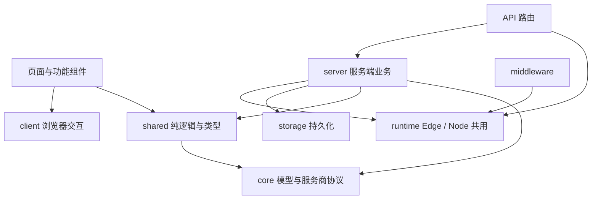

# 项目结构与维护指南

项目保留两个 workspace：`packages/core` 负责服务商协议和统一用量模型，`apps/web` 负责页面、HTTP 接口和持久化。Core 直接以 TypeScript 源码供 Next.js 编译，不增加独立构建步骤。

## 目录职责

```text
apps/web/
├── app/                       # Next.js 页面、布局与 API 入口
├── components/
│   ├── accounts/              # 账号管理、账号资料、凭据表单和 JSON 导入
│   ├── auth/                  # 登录弹窗
│   ├── dashboard/             # 用量卡片、进度条、历史曲线
│   └── layout/                # 顶部导航与品牌标志
├── client/                    # 浏览器交互 hooks
├── shared/                    # 纯计算、格式化、接口类型、凭据 JSON 解析
├── runtime/                   # Edge 与 Node 共用的环境配置和会话签名
├── server/
│   ├── credentials/           # 凭据输入校验与更新规则
│   ├── security/              # 凭据加解密、DNS 层 SSRF 校验
│   ├── storage/
│   │   ├── db.ts              # SQLite 连接、建表与旧账号迁移
│   │   ├── accounts.ts        # 账号资料、启停设置与旧槽位兼容
│   │   ├── credentials.ts     # 凭据持久化与并发更新校验
│   │   ├── snapshots.ts       # 最新用量、历史记录与范围读取
│   │   ├── alert-state.ts     # 通知状态与冷却记录
│   │   ├── cleanup.ts         # 清除快照、历史和提醒的共用操作
│   │   └── index.ts           # 存储层公开接口
│   ├── usage/                 # 采集编排、请求合并与后台轮询
│   └── notify/                # 提醒规则、消息构建、通知渠道
└── tests/
    ├── helpers/load-web.cjs   # 隔离模块缓存、TS/TSX 编译与依赖替换
    └── *.test.cjs             # API、数据库、通知、渲染等回归测试

packages/core/
├── src/
│   ├── model.ts               # 用量数据语义
│   ├── adapter.ts             # 服务商契约、错误类型、策略管线
│   ├── registry.ts            # 服务商注册
│   ├── usage-fetcher.ts       # 可注入存储与 HTTP 的采集流程
│   ├── http.ts / net.ts       # HTTP 传输与地址字面量校验
│   ├── decode.ts / reset.ts   # 容错解码与配额重置检测
│   └── providers/             # 服务商实现与各自的解析、OAuth 辅助模块
└── tests/                     # 无真实凭据的协议和采集测试

scripts/
├── setup-env.mjs              # 本地环境初始化
├── test.mjs                   # Core 与 Web 的统一测试入口
└── check-boundaries.mjs       # 模块依赖方向检查
```

## 依赖方向



- `shared/` 不读取环境变量，不访问数据库、文件系统或网络，也不依赖 React 组件。账号接口类型在这里定义，服务端存储使用同一份账号类型；凭据字段类型复用 Core 契约。
- `runtime/` 仅放 Edge 与 Node 均能执行的配置、鉴权逻辑。不要引入 `node:*`、SQLite 或其他服务端模块。它包含敏感配置，不能被浏览器代码引用。
- `client/`、`components/` 与标记了 `use client` 的页面可以引用 `shared/`，不能直接或间接引入 `server/`、`runtime/`。
- `server/storage/` 对外通过 `index.ts` 提供接口，内部引用具体文件，避免通过自身入口形成循环依赖。SQL、密文和数据库行格式留在存储层。
- `packages/core` 不依赖 Next.js、React 或 Web 应用。只有服务端采集器调用上游用量接口。
- `pnpm check:boundaries` 使用 TypeScript 语法树检查本地静态导入、重新导出和字符串形式的动态导入，忽略类型导入，并沿本地依赖检查浏览器与 Edge 边界。它也检查本地模块是否存在。此检查不能代替第三方依赖的运行时兼容性验证。

## 修改功能时从哪里开始

| 需求                 | 优先修改的位置                                                                       | 验证重点                                   |
| -------------------- | ------------------------------------------------------------------------------------ | ------------------------------------------ |
| 新增服务商           | `core/src/providers/`、`registry.ts`、`model.ts`                                     | Core 协议测试、未知额度与续期失败          |
| 账号别名、分组、启停 | `components/accounts/`、`api/accounts/`、`storage/accounts.ts`                       | 多账号隔离、停用后停止采集                 |
| 凭据表单或 JSON 导入 | `components/accounts/`、`shared/credential-import.ts`、`server/credentials/input.ts` | 字段校验、不泄露凭据、替换清理旧数据       |
| 自动刷新、重试或轮询 | `server/usage/`、`core/src/usage-fetcher.ts`                                         | 同账号请求合并、轮换后保存、停用和删除竞态 |
| 历史曲线             | `shared/usage-history.ts`、`storage/snapshots.ts`、`components/dashboard/`           | 缺失值断线、采样压缩、访客账单过滤         |
| 通知规则或渠道       | `server/notify/`                                                                     | 冷却持久化、恢复消息、每账号独立状态       |
| 数据库结构           | `server/storage/db.ts` 与对应存储模块                                                | 旧数据升级、迁移幂等性、重启后状态保持     |

## 本轮清理范围

已删除没有调用者的 `remainingPercent`、`hasRateWindows` 和 `FetchResult` 定义，以及从未被代码使用的 `zod` 依赖。开启 `noUnusedLocals` / `noUnusedParameters`，让未使用的局部代码在类型检查时报错；导出的闲置接口仍需要结合引用和兼容性人工判断。

`store.ts` 按职责拆成存储模块，共用的数据清理集中在 `cleanup.ts`；多份测试中的转译和模块加载合并到同一个 helper，每个测试 fixture 仍有独立缓存和 mock。重启测试清空完整模块缓存，避免新存储模块保留已关闭的 SQLite 连接。测试入口更名为 `test.mjs`，反映它同时运行 Core 与 Web 测试。

没有删除 `codex2`、旧 `provider` 参数、`/api/providers` 写接口或数据库旧字段：这些仍承担升级和客户端兼容职责，且有回归测试。`provider_settings`、`credentials.enabled` 和旧存储键也继续保留。移除这些内容需要单独制定升级方案与兼容期，不能按“前端当前不调用”判定为无用代码。

没有修改页面样式、API 路径、数据库结构、加密格式或部署入口。已有截图、部署调查文档和本地依赖缓存不属于无用源代码；缓存通过忽略规则排除，不做物理删除。

## 日常验证

先使用 `.nvmrc` 指定的 Node 22，再运行：

```bash
pnpm check:boundaries
pnpm typecheck
pnpm test
pnpm build
```

SQLite 是原生模块。若出现 `NODE_MODULE_VERSION` 不匹配，应先核对 Node 版本，再决定是否需要重新安装依赖。测试使用临时数据库和合成凭据，不需要真实上游账号。

CI 执行上述四项检查。后续按功能增加文件，优先放入已有职责目录；当前规模不需要再引入框架层、ORM 或额外 workspace。
